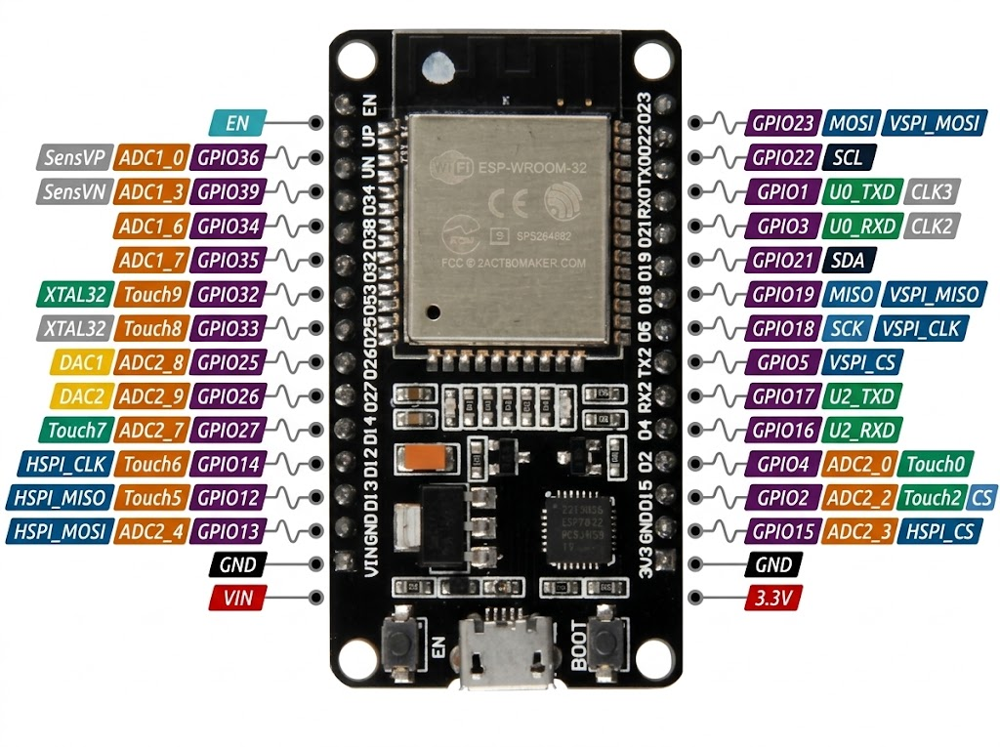
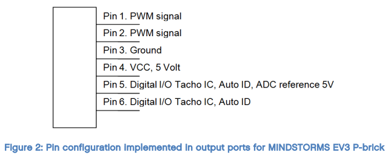

# Documentação Completa de Pinagem e Hardware

Este documento detalha o mapeamento físico do **ESP32 DevKit**, as restrições elétricas de cada GPIO e a descrição funcional de todos os terminais dos módulos periféricos utilizados no robô (**INA219**, **MPU-6050**, **VL53L1X**, **DRV8833**, **Motores Lego Mindstorms NXT** e **Servo motores MG996R**).

---

## Diagrama de Referência — ESP32 DevKit

  

---

## Resumo das Conexões do Projeto

| Subsistema               | Pino do Componente                  |      GPIO ESP32       |   Pino Físico    | Observação Técnica                                             |
| :----------------------- | :---------------------------------- | :-------------------: | :--------------: | :------------------------------------------------------------- |
| **Barramento I2C**       | `SDA` (VL53L1X + MPU-6050 + INA219) |      **GPIO 21**      |     Pino 26      | Comunicação de dados I2C                                       |
| **Barramento I2C**       | `SCL` (VL53L1X + MPU-6050 + INA219) |      **GPIO 22**      |     Pino 29      | Clock do barramento I2C                                        |
| **DRV8833 (Ponte H)**    | `IN1` / `IN2`                       |   **GPIO 12 / 13**    |  Pinos 12 / 13   | Controle PWM e Direção — Motor A                               |
| **DRV8833 (Ponte H)**    | `IN3` / `IN4`                       |   **GPIO 18 / 19**    |  Pinos 24 / 25   | Controle PWM e Direção — Motor B                               |
| **Encoders NXT (Alim.)** | `VCC` / `GND` (Lógica Aux.)         |   **GPIO 32 / 33**    |   Pinos 6 / 7    | Alimentação lógica (`GPIO 32 = HIGH`, `GPIO 33 = LOW`)         |
| **Encoders NXT (Sinal)** | `Canal A` (Fases 1 e 2)             |   **GPIO 34 / 35**    |   Pinos 4 / 5    | _Input-only_, Leitura de quadratura via Interrupção (`RISING`) |
| **Encoders NXT (Sinal)** | `Canal B` (Fases 1 e 2)             |   **GPIO 36 / 39**    |   Pinos 2 / 3    | _Input-only_, Leitura de quadratura via Interrupção (`RISING`) |
| **Servo motores Garra**  | `PWM` (MG996R)                      | **GPIO 25 / 26 / 27** | Pinos 8 / 9 / 10 | Sinal de controle, com alimentação externa                     |

---

## Mapeamento Completo da Placa (Planilha de Alocação)

A tabela abaixo reflete o espelho físico da placa ESP32 DevKit, lado a lado, restrições de hardware e a alocação atual do projeto:

| Pino Esq. |   Nome    |     Uso no Projeto     |   Observação (Esquerda)   |   Observação (Direita)    |   Uso no Projeto    |   Nome    | Pino Dir. |
| :-------: | :-------: | :--------------------: | :-----------------------: | :-----------------------: | :-----------------: | :-------: | :-------: |
|   **1**   |   `EN`    |           —            |         _Enable_          |             —             |          —          | `GPIO 23` |  **30**   |
|   **2**   | `GPIO 36` |  **Encoder B (Ch1)**   |       _Input Only_        |     Padrão I2C _SCL_      |     **I2C SCL**     | `GPIO 22` |  **29**   |
|   **3**   | `GPIO 39` |  **Encoder B (Ch2)**   |       _Input Only_        |             —             |          —          | `GPIO 1`  |  **28**   |
|   **4**   | `GPIO 34` |  **Encoder A (Ch1)**   |       _Input Only_        |             —             |          —          | `GPIO 3`  |  **27**   |
|   **5**   | `GPIO 35` |  **Encoder A (Ch2)**   |       _Input Only_        |      Padrão I2C SDA       |     **I2C SDA**     | `GPIO 21` |  **26**   |
|   **6**   | `GPIO 32` | **VCC Encoder / Hab.** |         _Output_          | Controle _PWM_ da rotação |  **Motor B (IN4)**  | `GPIO 19` |  **25**   |
|   **7**   | `GPIO 33` | **GND Encoder / Hab.** |         _Output_          | Sentido de Rotação _1/0_  |  **Motor B (IN3)**  | `GPIO 18` |  **24**   |
|   **8**   | `GPIO 25` |    **ServoMotores**    | Controle _PWM_ da rotação |             —             |          —          | `GPIO 5`  |  **23**   |
|   **9**   | `GPIO 26` |    **ServoMotores**    | Controle _PWM_ da rotação |             —             |          —          | `GPIO 17` |  **22**   |
|  **10**   | `GPIO 27` |    **ServoMotores**    | Controle _PWM_ da rotação |             —             |          —          | `GPIO 16` |  **21**   |
|  **11**   | `GPIO 14` |           —            |             —             |             —             |          —          | `GPIO 4`  |  **20**   |
|  **12**   | `GPIO 12` |   **Motor A (IN1)**    | Sentido de Rotação _1/0_  |             —             |          —          | `GPIO 2`  |  **19**   |
|  **13**   | `GPIO 13` |   **Motor A (IN2)**    | Controle _PWM_ da rotação |             —             |          —          | `GPIO 15` |  **18**   |
|  **14**   |   `GND`   |       **Terra**        |   Pino _GND_ principal    |       Pino de terra       |    **Terra I2C**    |   `GND`   |  **17**   |
|  **15**   |   `VIN`   |     **Entrada 5V**     | Alimentação externa $5V$  |   Saída regulada $3.3V$   | **Alimentação I2C** |  `3.3V`   |  **16**   |

---

## Dicionário de Pinos e Detalhamento por Componente

Abaixo está a explicação de **todos os pinos presentes em cada módulo**, sua função eletrônica e como eles estão configurados no nosso hardware.

---

### 1. Monitor de Corrente e Tensão — INA219

O **INA219** é um monitor de derivação de corrente (shunt) e tensão compatível com I2C. Ele mede a queda de tensão em um resistor shunt interno para calcular a corrente que flui para os motores ou circuito, além de medir a tensão total da bateria, fornecendo dados vitais para cálculo de consumo e telemetria da bateria. O módulo possui **6 pinos**:

- **`VCC`**: Entrada de alimentação lógica do módulo ($3.0V$ a $5.5V$).
- **`GND`**: Referência de terra lógica.
- **`SCL` (Serial Clock Line)**: Linha de sinal de clock do barramento I2C principal.
- **`SDA` (Serial Data Line)**: Linha bidirecional de dados do barramento I2C principal.
- **`VIN+`**: Conectado ao terminal positivo da fonte de alimentação.
- **`VIN-`**: Conectado à carga (resto da eletrônica). A corrente flui do VIN+ para o VIN- passando pelo resistor shunt.

#### O que é usado no projeto (INA219):

| Pino do Módulo |  Status   | Conexão no ESP32 / Robô | Justificativa no Projeto                                              |
| :------------: | :-------: | :---------------------: | :-------------------------------------------------------------------- |
|     `VCC`      | **Usado** |    `3.3V` (Pino 16)     | Alimentação lógica do I2C.                                            |
|     `GND`      | **Usado** |     `GND` (Pino 17)     | Terra comum no barramento I2C.                                        |
|     `SCL`      | **Usado** |   `GPIO 21` (Pino 26)   | Clock da comunicação I2C, compartilhado com o VL53L1X E MPU-6050.     |
|     `SDA`      | **Usado** |   `GPIO 22` (Pino 29)   | Tráfego de dados no endereço padrão (_0x40_).                         |
|     `VIN+`     | **Usado** |     `V+` da Bateria     | Ponto de entrada da alimentação de todo o sistema.                    |
|     `VIN-`     | **Usado** |   Resto da eletrônica   | Usado em série com o circuito para medir a corrente total do sistema. |

> Observação: para que o INA219 seja capaz de aguentar a corrente do sistema, será feito a troca do resistor shunt de 100 para 200.

### 2. Sensor de Distância a Laser (ToF) — VL53L1X

O **VL53L1X** é um sensor _Time-of-Flight_ (Tempo de Voo) que mede a distância absoluta até o alvo independentemente da cor, calculando o tempo que fótons de um laser infravermelho levam para ir e voltar. O módulo possui **6 pinos**:

- **`VIN` (ou `VCC`)**: Entrada de alimentação principal ($2.6V$ a $5.5V$) em módulos com regulador onboard.
- **`GND`**: Referência de terra.
- **`SCL` (Serial Clock Line)**: Linha de sinal de clock do barramento I2C principal. Sincroniza a transferência de bits entre o ESP32 (Master) e o VL53L1X (Slave).
- **`SDA` (Serial Data Line)**: Linha bidirecional de dados do barramento I2C principal, por onde trafegam os endereços dos registradores e a leitura de distância.
- **`XSHUT` (Shutdown / Reset)**: Pino de desligamento e reset de hardware (ativo em nível baixo, `LOW`). Quando colocado em `LOW`, o sensor entra em _hardware standby_ e fica invisível no barramento I2C. É necessário quando se usa **múltiplos VL53L1X** no mesmo barramento para alternar entre os sensores, allterando seus endereços I2C individualmente durante o `setup()`.
- **`GPIO1` (Interrupt Output)**: Saída de interrupção programável (coletor aberto) que avisa o microcontrolador quando uma nova medição de distância terminou ou quando um objeto cruzou um limiar de distância pré-configurado.

#### O que é usado no projeto (VL53L1X):

| Pino do Módulo    |   Status    |   Conexão no ESP32   | Justificativa no Projeto                                                                                                                                                 |
| :---------------- | :---------: | :------------------: | :----------------------------------------------------------------------------------------------------------------------------------------------------------------------- |
| **`VIN` / `VCC`** |  **Usado**  |   `3.3V` (Pino 16)   | Alimentação em $3.3V$ compatível com a lógica do ESP32.                                                                                                                  |
| **`GND`**         |  **Usado**  |   `GND` (Pino 17)    | Terra comum do barramento.                                                                                                                                               |
| **`SDA`**         |  **Usado**  | `GPIO 21` (Pino 26)  | Comunicação de dados I2C no endereço padrão **`0x29`**.                                                                                                                  |
| **`SCL`**         |  **Usado**  | `GPIO 22` (Pino 29)  | Clock I2C.                                                                                                                                                               |
| **`XSHUT`**       | _Não usado_ | _Flutuante (`HIGH`)_ | Como há apenas um VL53L1X no barramento e seu endereço não conflita nem com o IMU (0x68) e nem o INA (0x40), o resistor de pull-up interno do módulo já o mantém ligado. |
| **`GPIO1`**       | _Não usado_ |    _Desconectado_    | O sensor opera em modo contínuo (`startContinuous(50)`) sincronizado com o loop principal e não em captação de dados discreto para determinar os ciclos de captura.      |

---

### 3. Unidade de Medida Inercial (IMU) — MPU-6050 (GY-521)

O módulo **GY-521 (MPU-6050)** combina um acelerômetro de 3 eixos e um giroscópio de 3 eixos com um processador interno chamado DMP (_Digital Motion Processor_). Ele possui **8 pinos**:

- **`VCC`**: Entrada de alimentação do módulo. O breakout GY-521 possui um regulador de tensão LDO interno, aceitando entre $3.3V$ e $5V$.
- **`GND`**: Referência de terra comum com o microcontrolador.
- **`SCL` (Serial Clock Line)**: Linha de sinal de clock do barramento I2C principal. Sincroniza a transferência de bits entre o ESP32 (Master) e o MPU-6050 (Slave).
- **`SDA` (Serial Data Line)**: Linha bidirecional de dados do barramento I2C principal, por onde trafegam os endereços dos registradores e as leituras de aceleração, giroscópio e temperatura.
- **`XDA` (Auxiliary Serial Data)**: Linha de dados do barramento I2C _auxiliar_ (secundário). Serve para conectar um magnetômetro externo (como o HMC5883L ou QMC5883L) diretamente ao MPU-6050, permitindo que o próprio sensor faça a fusão de 9 eixos internamente.
- **`XCL` (Auxiliary Serial Clock)**: Linha de clock do barramento I2C _auxiliar_ para sincronizar o sensor externo conectado ao `XDA`.
- **`AD0` (Address Select Pin)**: Pino de seleção do bit menos significativo (LSB) do endereço I2C do sensor:
  - Se `AD0 = LOW` (ou flutuante, devido ao pull-down interno da placa): Endereço I2C = **`0x68`**.
  - Se `AD0 = HIGH` ($3.3V$): Endereço I2C = **`0x69`** (útil quando há dois MPU-6050 no mesmo barramento).
- **`INT` (Interrupt Output)**: Pino de saída de interrupção de hardware. Pode ser programado via registrador para disparar um pulso elétrico ao ESP32 sempre que uma nova leitura estiver pronta (_Data Ready_), quando o buffer FIFO encher ou ao detectar queda livre/impacto.

#### O que é usado no projeto (MPU-6050):

| Pino do Módulo    |   Status    |  Conexão no ESP32   | Justificativa no Projeto                                |
| :---------------- | :---------: | :-----------------: | :------------------------------------------------------ |
| **`VCC`**         |  **Usado**  |    `3.3V` (P16)     | Alimenta o modulo em $3.3V$                             |
| **`GND`**         |  **Usado**  |   `GND` (Pino 17)   | Referência de terra comum do circuito.                  |
| **`SCL`**         |  **Usado**  | `GPIO 22` (Pino 29) | Compartilhando o barramento com o VL53L1X e o INA219    |
| **`SDA`**         |  **Usado**  | `GPIO 21` (Pino 26) | Trafego de dados através do endereço `0x68`.            |
| **`XDA` / `XCL`** | _Não usado_ |   _Desconectados_   | Não terá um magnetômetro para auxiliar o IMU.           |
| **`AD0`**         | _Não usado_ | _Flutuante (`LOW`)_ | Não terá outro IMU para ter que mudar o endereço atual. |
| **`INT`**         | _Não usado_ |   _Desconectado_    | Dados já repassados pela comunicação I2C `SDA`.         |

---

### 4. Driver de Motores (Ponte H Dupla) — DRV8833

O **DRV8833** é um driver de ponte H dupla baseado em MOSFETs de baixa resistência interna, capaz de controlar até 2 motores DC independentemente com corrente contínua de até $1.2A$ por canal (picos de $2A$). O módulo possui **12 terminais**:

- **`VCC`**: Tensão de alimentação dos motores ($2.7V$ a $10.8V$).
- **`GND`**: Terra comum entre a fonte e a lógica do ESP32.
- **`IN1` e `IN2`**: Entradas lógicas de controle da Ponte H do **Motor A**. Determinam o sentido de giro, freio eletrônico ou roda livre (_coast_) e recebem o sinal PWM de velocidade.
- **`IN3` e `IN4`**: Entradas lógicas de controle da Ponte H do **Motor B**.
- **`OUT1` e `OUT2`**: Saídas conectadas diretamente aos terminais do **Motor A**.
- **`OUT3` e `OUT4`**: Saídas conectadas diretamente aos terminais do **Motor B**.
- **`EEP` (`nSLEEP`)**: Pino de controle do modo de baixo consumo. Em nível `LOW`, coloca o chip em modo _Sleep_ desativando as pontes H. Precisa estar em nível `HIGH` para os motores funcionarem.
- **`ULT` (`nFAULT`)**: Saída de diagnóstico de falha (ativo em `LOW`). O DRV8833 puxa este pino para `LOW` caso ocorra sobrecorrente, curto-circuito nos terminais do motor, subtensão ou superaquecimento térmico (_Thermal Shutdown_).

#### Tabela Verdade de Controle (DRV8833)

|    `IN1`     |    `IN2`     | Comportamento da Saída (`OUT1` / `OUT2`)                                       |
| :----------: | :----------: | :----------------------------------------------------------------------------- |
| `LOW` ($0$)  | `LOW` ($0$)  | **Solto:** Saídas em alta impedância ($Z$), deixa os motores em inércia.       |
| `HIGH` ($1$) | `LOW` ($0$)  | **Giro Direto:** Corrente flui de `OUT1` $\rightarrow$ `OUT2`.                 |
| `LOW` ($0$)  | `HIGH` ($1$) | **Giro Reverso:** Corrente flui de `OUT2` $\rightarrow$ `OUT1`.                |
| `HIGH` ($1$) | `HIGH` ($1$) | **Brake:** Ambos os terminais do motor são curto-circuitados, freando o rotor. |

> ⚠️ **Nota sobre PWM em `Slow Decay` (como usado no código `03_drv8833_nxt_encoder.ino`):**
> Quando mantemos `IN2 = HIGH` fixo e aplicamos `analogWrite(IN1, velocidade)`, o ciclo ativo em `HIGH` aplica freio e o ciclo em `LOW` aplica tensão reversa. Portanto, com `IN2 = HIGH`, um valor de PWM `0` resulta em velocidade máxima (100% do tempo em `LOW`/`HIGH`) e `255` resulta no motor parado/freado (`HIGH`/`HIGH`). Se quiser que `255` seja velocidade máxima em modo _Fast Decay_, basta manter o pino de direção em `LOW` e aplicar o `analogWrite()` no outro pino!

#### O que é usado no projeto (DRV8833):

|    Pino do Módulo    |   Status    | Conexão no ESP32 / Robô | Justificativa no Projeto                                |
| :------------------: | :---------: | :---------------------: | :------------------------------------------------------ |
|   **`VM` / `GND`**   |  **Usado**  |          Fonte          | Alimentação dos motores e referência comum com o ESP32. |
|  **`IN1` / `IN2`**   |  **Usado**  |     `GPIO 12 / 13`      | Controle de velocidade PWM e sentido do **Motor A**.    |
|  **`IN3` / `IN4`**   |  **Usado**  |     `GPIO 18 / 19`      | Controle de velocidade PWM e sentido do **Motor B**.    |
| **`OUT1`...`OUT4`**  |  **Usado**  |       Fios (NXT)        | Alimentam os dois motores Lego Mindstorms NXT.          |
| **`ULT` (`nFAULT`)** | _Não usado_ |     _Desconectado_      | Alerta de falhas térmicas e de sobrecorrente.           |

---

### 5. Sistema de Locomoção — Lego Mindstorms NXT (com Encoder Óptico)

Os motores do **Lego Mindstorms NXT** utilizam um conector proprietário de 6 vias (RJ12 modificado com trava lateral deslocada) que integra tanto a alimentação de potência do motor DC com caixa de redução planetária quanto um **encoder óptico incremental em quadratura** de alta precisão ($360\text{ pulsos por rotação}$ no eixo de saída, ou $720\text{ bordas}$ contando ambas as fases).

Os **6 fios do cabo Lego NXT** possuem o seguinte padrão oficial de cores e funções:

  

1. **Pino 1 | Fio Branco (`MA`):** Primeiro terminal do motor DC (tensão nominal de $9V$).
2. **Pino 2 | Fio Preto (`MB`):** Segundo terminal do motor DC. Inverter a polaridade entre os fios Branco e Preto inverte o sentido de rotação.
3. **Pino 3 | Fio Vermelho (`GND`):** Terra comum para o sensor óptico e placa interna.
4. **Pino 4 | Fio Verde (`VCC`):** Alimentação lógica ($4.3V$ a $5V$) do circuito do encoder óptico interno.
5. **Pino 5 | Fio Amarelo (`DIG0`):** Saída digital do canal A do encoder óptico (onda quadrada).
6. **Pino 6 | Fio Azul (`DIG1`):** Saída digital do canal B do encoder óptico com uma defasagem física de _90º_ em relação ao fio amarelo. Essa defasagem permite saber não apenas quantos graus, mas também em qual direção está girando.

> Créditos ao dado das cores dos fios para: https://github.com/RBinsonB/LEGO_NXT_myRIO/blob/master/README.md

#### O que é usado no projeto (Motores e Encoders NXT):

Para o projeto atual foi construido um fio específico que junta os pinos para controle de 2 motores Lego Mindstorm NXT, criando-se assim, um barramento de 6 pinos equivalente ao conjunto especificado acima mais 4 fios de alimentação dos motores.

| Fio / Pino NXT    |  Status   |   Conexão no Hardware   | Justificativa no Projeto                                                                                              |
| :---------------- | :-------: | :---------------------: | :-------------------------------------------------------------------------------------------------------------------- |
| **Alimentação**   | **Usado** | Saídas `OUT` do DRV8833 | Recebem a potência modulada por PWM diretamente da Ponte H.                                                           |
| **`VCC` Encoder** | **Usado** |   `GPIO 32` (`HIGH`)    | Fornece alimentação lógica de $3.3V$ via software (`digitalWrite(32, HIGH)`) para os circuitos ópticos dos encoders.  |
| **`GND` Encoder** | **Usado** |    `GPIO 33` (`LOW`)    | Fornece referência de terra via software (`digitalWrite(33, LOW)`).                                                   |
| **Motor A**       | **Usado** |     `GPIO 34 / 35`      | Conectados às portas _Input-Only_ do ESP32 com interrupção externa (`attachInterrupt`) na borda de subida (`RISING`). |
| **Motor B**       | **Usado** |     `GPIO 36 / 39`      | Conectados às portas _Input-Only_ do ESP32 com interrupção externa (`attachInterrupt`) na borda de subida (`RISING`). |

> ⚠️ **Atenção Crítica às GPIOs 34, 35, 36 e 39 do ESP32:**
> Estes 4 pinos pertencem ao bloco de entrada pura (_GPIs_) do ESP32. Eles são excelentes para interrupções de encoders pois não possuem circuitos de saída que gerem capacitância parasita, **porém eles NÃO possuem resistores de pull-up ou pull-down internos (`INPUT_PULLUP` não tem efeito neles)**. Como o encoder do Lego NXT possui saída ativa interna (com resistores de pull-up próprios integrados ao circuito do motor), o sinal funciona diretamente; caso haja ruído eletromagnético dos motores, recomenda-se adicionar resistores externos de $10\text{ k}\Omega$ entre os fios Amarelo/Azul e o $3.3\text{ V}$.

### 6. Servo motores MG996R

#### O que é usado no projeto:
