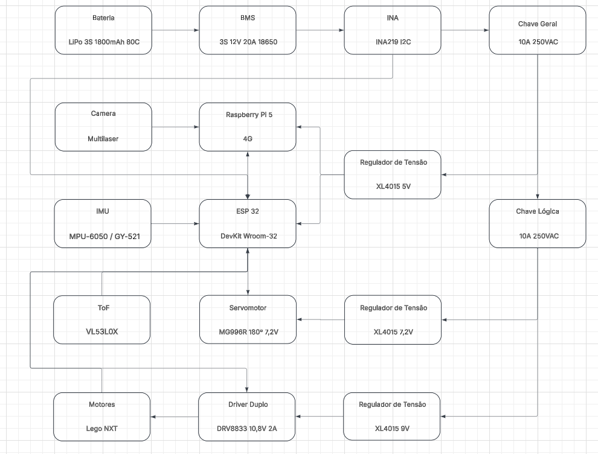

# ESP32 Rover — Hardware Bring-Up & Sensor Suite

Repositório contendo a documentação elétrica, mapeamento de pinos e códigos de validação unitária e integração de sensores e atuadores baseados em **ESP32**.

## Hardware Utilizado

- **Microcontrolador:** ESP32 DevKit V1 (30 Pinos)
- **Sensor de Distância (ToF):** VL53L1X (I2C - Endereço `0x29`)
- **Monitor de Corrente e Tensão (INA):** INA219 (I2C - Endereço `0x40`)
- **Unidade Inercial (IMU):** MPU-6050 6-DOF (I2C - Endereço `0x68`)
- **Driver de Motores:** Ponte H Dupla DRV8833
- **Atuadores de Locomoção:** Motores DC Lego Mindstorms NXT com Encoders Ópticos integrados
- **Atuadores da Garra:** Servomotores MG996R

---

## Esquemática do Sistema

<p align="center">
  
</p>

---

## Arquitetura do Diretório (`/eletronica`)

```text
📂 eletronica
 ┣ 📂 ESP32 DevKit/
 ┃ ┣ 📜 LEGO MINDSTORMS EV3 Hardware Developer Kit.pdf  # Datasheet oficial de referência dos motores/encoders Lego
 ┃ ┣ 🖼️ padraoCaboNXT.png                               # Pinagem interna do conector RJ12 modificado (NXT)
 ┃ ┣ 🖼️ pinagemESP32.png                                # Diagrama de referência do ESP32 DevKit (30 pinos)
 ┃ ┗ 📜 pinout.md                                       # Documentação completa de pinos e dicionário de hardware
 ┣ 📂 Programação/
 ┃ ┣ 📜 scanner.ino                                     # Diagnóstico de barramento e endereços I2C
 ┃ ┣ 📜 VL53L1X.ino                                     # Teste unitário do sensor de distância a laser (ToF)
 ┃ ┣ 📜 MPU-6050.ino                                    # Teste unitário do acelerômetro e giroscópio (IMU)
 ┃ ┣ 📜 INA219.ino                                      # Teste unitário do sensor de corrente e tensão
 ┃ ┗ 📜 DRV8833.ino                                     # Teste da Ponte H com leitura dos encoders Lego NXT
 ┣ 🖼️ esquematicaEletro.png                             # Diagrama esquemático geral da eletrônica
 ┗ 📜 README.md                                         # Documentação principal do diretório
```

> 📌 **Documentação Detalhada de Pinagem:** Para consultar a tabela completa de alocação de GPIOs do ESP32 e a explicação de todos os pinos de cada módulo, acesse [**`ESP32 DevKit/pinout.md`**](./ESP32%20DevKit/pinout.md).

---

## Estrutura de Testes (`Programação/`)

Os códigos na pasta `Programação/` permitem validar cada subsistema de forma isolada antes da integração final:

1. **`scanner.ino`**: Varre o barramento I2C a 100 kHz para garantir que não há mau contato, falta de resistores de pull-up ou conflito de endereços (`0x29`, `0x40` e `0x68`) antes de inicializar os sensores.
2. **`VL53L1X.ino`**: Valida o sensor a laser VL53L1X isoladamente em Fast Mode (400 kHz) e modo `Long` (até 4 metros) com _Timing Budget_ de 50 ms, exibindo a distância em milímetros e a taxa de retorno de sinal (MCPS).
3. **`MPU-6050.ino`**: Realiza a leitura direta dos registradores do MPU-6050 (`0x3B` a `0x48` via _burst read_ de 14 bytes) em Fast Mode (400 kHz), convertendo os dados brutos para aceleração ($\text{g}$), velocidade angular ($^\circ/\text{s}$) e temperatura ($^\circ\text{C}$).
4. **`INA219.ino`**: Monitora em tempo real a tensão do barramento ($\text{V}$), a queda de tensão no resistor shunt ($\text{mV}$), a corrente total consumida pelo sistema ($\text{mA}$) e a potência elétrica ($\text{mW}$), já considerando a calibração para o resistor shunt modificado (`R200`).
5. **`DRV8833.ino`**: Executa rampas de aceleração e desaceleração PWM no driver DRV8833 enquanto contabiliza os pulsos em quadratura dos encoders ópticos dos motores Lego NXT via interrupções de hardware (`IRAM_ATTR`).

_(Em breve: código unitário para os servomotores **MG996R** e rotina de integração completa operando simultaneamente todos os sensores e atuadores)._

---

## Como Executar

1. Instale a **Arduino IDE** (ou extensão **PlatformIO** no VS Code) com o pacote de placas **ESP32 by Espressif Systems**.
2. No Gerenciador de Bibliotecas da Arduino IDE, instale:
   - `VL53L1X` by **Pololu**
   - `Adafruit INA219` by **Adafruit**
3. Abra o arquivo `.ino` desejado na pasta `Programação/` (caso a Arduino IDE solicite a criação de uma pasta de mesmo nome para o sketch, confirme), selecione a placa **ESP32 Dev Module** e faça o upload.
4. Abra o Monitor Serial configurado com Baud Rate de **`115200`**.
